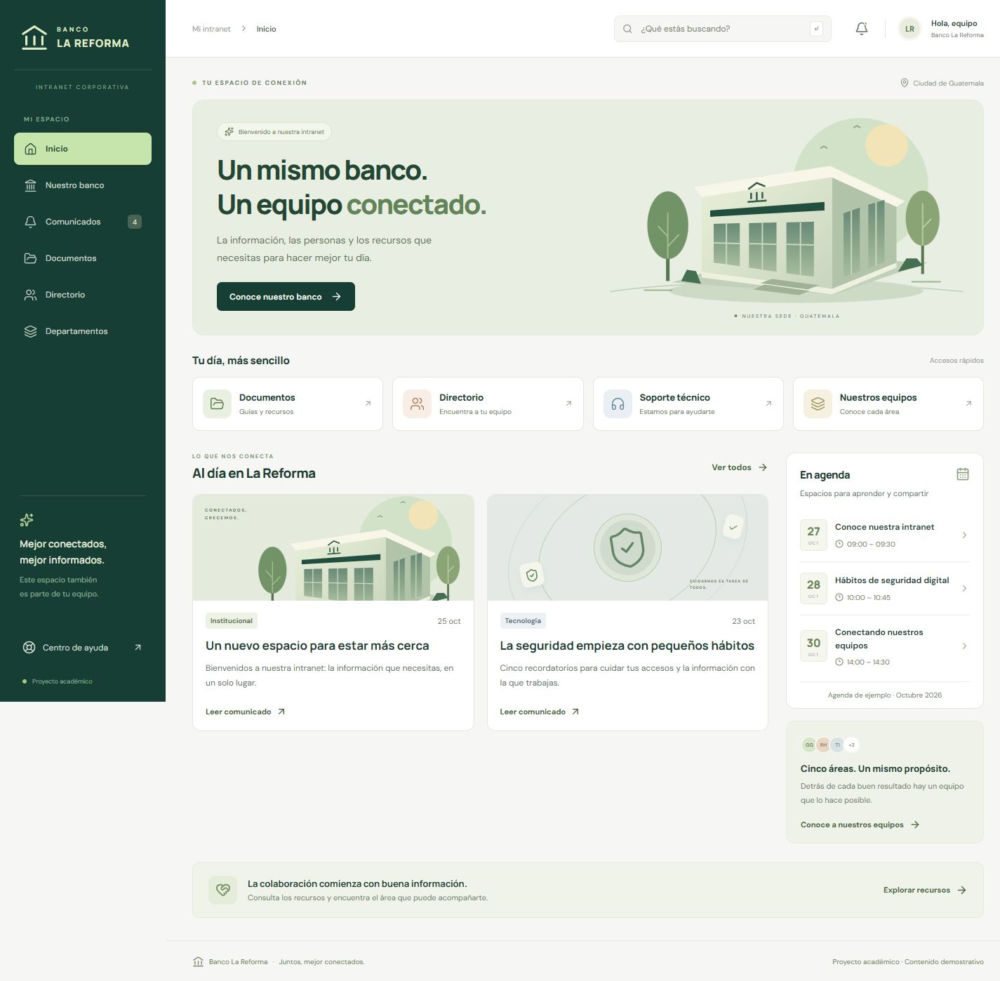

# Banco La Reforma · Intranet

Portal informativo del proyecto del curso de Intranet. Está construido con **React y Vite**, en JavaScript y CSS, para editarlo en Visual Studio Code en la computadora física. No requiere iniciar Ubuntu ni VirtualBox.



## Descargar y ejecutar el proyecto compartido

Repositorio: https://github.com/LuisRuiz16/banco-la-reforma-intranet

```bash
git clone https://github.com/LuisRuiz16/banco-la-reforma-intranet.git
cd banco-la-reforma-intranet
docker compose up -d --build
docker compose ps
```

Con Docker y el complemento Compose instalados, abre **http://127.0.0.1:8095/** en el equipo donde ejecutaste el comando. No necesitas instalar Node.js en ese equipo para construir con Docker: el Dockerfile lo incluye. La primera construcción necesita Internet para descargar imágenes y dependencias.

Si no tienes Git, usa **Code → Download ZIP**, descomprime el archivo y abre una terminal en la carpeta que contiene `compose.yaml`.

### Publicar desde Ubuntu para otras máquinas del laboratorio

1. Comprueba la IP de tu VM con `ip -br address`.
2. Copia `.env.example` a `.env` con `cp .env.example .env` y pon esa IP en `LAB_BIND_IP`. El valor de ejemplo es `127.0.0.1` (solo acceso local); cámbialo por la IP de tu VM para permitir el acceso desde otros equipos.
3. Ejecuta **solo la variante de Ubuntu**:

```bash
sudo docker compose -f compose.ubuntu.yaml up -d --build
sudo docker compose -f compose.ubuntu.yaml ps
```

Las otras máquinas deben poder comunicarse con esa IP y entrar en `http://IP_DE_UBUNTU:8095/`. Sustituye `IP_DE_UBUNTU` por la IP real del servidor de tu laboratorio. El firewall del laboratorio debe permitir el puerto TCP 8095 desde los clientes autorizados. El archivo Compose no cambia la red de VirtualBox ni la IP del sistema operativo.

`compose.yaml` y `compose.ubuntu.yaml` son alternativas para el mismo contenedor: no los levantes simultáneamente en el mismo equipo. Si ya ejecutaste la variante local, detenla antes con `docker compose down`; después inicia la variante de Ubuntu.

Para editar en Visual Studio Code sin Docker, instala **Node.js 24**, abre la carpeta y ejecuta `npm ci` y `npm run dev`. En PowerShell puedes utilizar `npm.cmd`.

**Alcance actual:** contenido estático, sin base de datos ni API propia. Keycloak y los roles `ADMIN` / `EMPLEADO` todavía no están implementados. La información editable está en `src/data/content.js`; los favoritos se guardan únicamente en el navegador. Consulta [las integraciones pendientes](docs/INTEGRACIONES.md).

## Abrirlo en esta computadora

1. Abre esta carpeta en Visual Studio Code: **Archivo → Abrir carpeta**.
2. Haz doble clic en **INICIAR-INTRANET.cmd** desde el Explorador de archivos. También puedes ejecutar la tarea **Abrir la intranet** desde el menú Terminal de VS Code.
3. El navegador abrirá **http://127.0.0.1:5173**.
4. Deja abierta la ventana que ejecuta el servidor. Para detenerlo, presiona **Ctrl+C** en esa ventana.

El archivo de inicio encuentra la instalación local de Node.js preparada para este equipo. Si compartes el proyecto, instala primero [Node.js LTS](https://nodejs.org/) y usa los mismos pasos. La primera instalación de dependencias necesita Internet.

Si aparece “Port 5173 is already in use”, normalmente ya existe una instancia de esta intranet: abre la dirección del paso 3. Para un segundo servidor utiliza `npm.cmd run dev -- --port 5174` y la dirección que muestre Vite.

## Ejecutarlo desde la terminal de VS Code

Abre una terminal nueva después de abrir la carpeta. Los archivos de configuración incluyen la ruta de Node.js de este equipo.

```powershell
npm.cmd ci
npm.cmd run dev
```

`npm.cmd` evita problemas de permisos de ejecución de scripts de PowerShell. No es necesario cambiar la política de seguridad de Windows.

Para comprobar y construir la versión de entrega:

```powershell
npm.cmd run build
npm.cmd run preview
```

La compilación se guarda en `dist/`. La vista previa se abre en **http://127.0.0.1:4173**. No abras `index.html` con doble clic: React necesita servirse mediante Vite o Nginx para que funcionen los módulos y las rutas.

## Lo que ya funciona

- Inicio con accesos rápidos, comunicados y agenda de ejemplo.
- Nuestro banco: descripción, sede y propósito de la intranet.
- Comunicados: búsqueda, categorías y lectura completa.
- Documentos: búsqueda por contenido descriptivo, filtro por área, vista previa y descarga real en `.txt`.
- Favoritos guardados en este navegador; no requieren cuenta.
- Directorio: perfiles de las cinco áreas, filtro y copia de contactos de ejemplo.
- Departamentos y enlaces a sus perfiles.
- Centro de ayuda con preguntas frecuentes y guía de soporte.
- Búsqueda global en comunicados, documentos y departamentos; también se enfoca con **Ctrl+K**.
- Diseño adaptable a escritorio, tableta y celular; navegación por teclado y ventanas que se cierran con **Escape**.

## Cambiar el contenido

Empieza por **`src/data/content.js`**. Cada sección tiene una lista fácil de editar:

| Lista         | Contenido que modifica                             |
| ------------- | -------------------------------------------------- |
| `bank`        | Descripción y propósito del banco                  |
| `departments` | Áreas, cargos, funciones y contactos               |
| `news`        | Comunicados, fechas, categorías y textos completos |
| `documents`   | Guías, versiones y secciones descargables          |
| `events`      | Agenda de demostración                             |
| `faqs`        | Preguntas y respuestas                             |

Ejemplo de un comunicado:

```js
{
  id: 'nuevo-comunicado', // Identificador único, sin espacios.
  title: 'Título del comunicado',
  category: 'Institucional',
  department: 'Gerencia General',
  date: '2026-10-26', // AAAA-MM-DD.
  readTime: '2 min',
  featured: false, // true para mostrarlo también en Inicio.
  visual: 'building', // building, security, people o documents.
  excerpt: 'Resumen breve.',
  body: ['Primer párrafo.', 'Segundo párrafo.'],
}
```

Guarda con **Ctrl+S**. Mientras Vite está abierto, el navegador se actualiza automáticamente. Los identificadores deben ser únicos. Mantén las comas, comillas y corchetes del ejemplo.

Para cambiar el diseño, edita **`src/styles.css`**. Al inicio están los colores principales (`--green`, `--lime`, etc.). Las páginas y componentes están en **`src/App.jsx`**. El punto de entrada es **`src/main.jsx`**.

## Qué viene de la propuesta y qué es demostrativo

Se utilizó como referencia **Proyecto Final - Entregable 0-1.pdf**, proporcionado por el equipo:

- Banco La Reforma es ficticio, de tamaño mediano, con una sede en Ciudad de Guatemala, y atiende a personas y pymes.
- Las cinco áreas son Gerencia General, Recursos Humanos, Tecnología, Operaciones y Cumplimiento. Los perfiles del directorio se basan en la propuesta.
- La necesidad es centralizar información y facilitar la colaboración.

Los comunicados, las fechas de agenda, las guías y los principios editoriales son **ejemplos redactados para la demostración**. Los correos usan el dominio reservado `.example` y las extensiones son ficticias. No se publicaron carnés, correos personales de los integrantes ni el PDF del equipo dentro de la aplicación.

## Alcance de esta entrega

Esta aplicación es **estática**: no tiene backend, base de datos, inicio de sesión, SSO, administración de usuarios ni permisos reales. No envía tickets y no procesa transacciones. Los botones de consulta, búsqueda y descarga sí funcionan.

No introduzcas información real de clientes ni documentos confidenciales: ocultar un botón en React no es un control de acceso. La autenticación, la autorización y los servicios de red son otras partes del proyecto final y deben integrarse y comprobarse por separado.

## Llevarlo a Docker

Con Docker Desktop abierto y el motor de contenedores Linux funcionando, abre una terminal en esta carpeta:

```powershell
docker compose up -d --build
docker compose ps
```

Abre **http://127.0.0.1:8095**. El contenedor se llama `banco-reforma-intranet`. El puerto se eligió para no utilizar el 8080 de prácticas anteriores.

- `Dockerfile` construye React con Node.js y publica `dist/` con Nginx.
- `nginx.conf` permite recargar rutas como `/documentos`, aplica cabeceras básicas y proporciona `/health`.
- `compose.yaml` publica el servicio únicamente en la computadora anfitriona para esta demostración.
- Para ver registros: `docker compose logs --tail 50`.
- Para detenerlo sin eliminar la imagen: `docker compose stop`.
- Tras cambiar el contenido: `docker compose up -d --build`.

Para Ubuntu y el acceso desde otras VMs utiliza `compose.ubuntu.yaml` y la variable `LAB_BIND_IP`, siguiendo los pasos del inicio de esta guía. Consulta [la guía genérica de Ubuntu](docs/DESPLIEGUE-UBUNTU.md). La red y la IP del servidor se configuran en cada laboratorio; no se crean automáticamente al clonar este repositorio.

Este contenedor usa HTTP local. Para la entrega final, configura HTTPS en el proxy y aplica HSTS **después** de disponer de un certificado confiable y HTTPS operativo. Las cabeceras no sustituyen a autenticación o permisos.

## Conectar después la mesa de servicios

1. Copia `.env.example` como `.env`.
2. Escribe una URL real en `VITE_HELPDESK_URL`.
3. Reinicia Vite o reconstruye Docker.

En Ayuda aparecerá un botón hacia la mesa externa. Solo se aceptan URL `http` o `https`. Si está vacío, se mantiene la guía de soporte. Las variables `VITE_` son públicas y se incorporan a la compilación; **nunca pongas contraseñas, tokens ni secretos en ellas**.

La integración de Keycloak no está implementada. Consulta **`docs/INTEGRACIONES.md`** para coordinar los datos necesarios y **`docs/EXPOSICION.md`** para presentar esta entrega con claridad.

## Archivos principales

```text
src/
  App.jsx                 Páginas, navegación y componentes
  data/content.js         Contenido editable del banco
  main.jsx                Arranque de React y fuentes locales
  styles.css              Diseño y adaptación a pantallas
public/favicon.svg        Símbolo del banco
docs/                     Guía de exposición e integración
Dockerfile                Construcción y publicación
compose.yaml              Ejecución con Docker
nginx.conf                Configuración del servidor web
INICIAR-INTRANET.cmd       Inicio sencillo en Windows
```

Las fuentes DM Sans y Manrope se distribuyen mediante paquetes locales; la aplicación compilada no necesita descargar fuentes de Google. El símbolo y las ilustraciones se construyeron en SVG para este proyecto.
